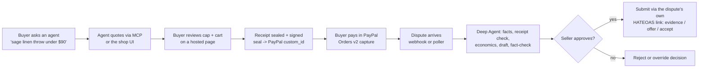

# Countersign

**Signed receipts for AI agent purchases, and a dispute agent that uses them.** Built for the PayPal AI Hackathon.

When a shopping agent buys something, nobody can later prove what the buyer actually asked for. Countersign records
every agent purchase as a hash-chained, Ed25519-signed **intent receipt** and writes the receipt's seal into the PayPal
order's `custom_id` *before payment*, so PayPal's own record carries the commitment. When a dispute arrives, a
LangChain Deep Agent pulls the order, verifies the receipt against PayPal, prices fight / offer / accept, and drafts the
response. **Nothing reaches PayPal until the seller approves.**

- Demo video: https://youtu.be/wKxl8Abr4Gw
- Live app (sandbox): https://countersign-black.vercel.app (shopper: no login; merchant console: `/login`)
- API (sandbox): https://countersign-api-z0wu.onrender.com · OpenAPI at `/docs` and `/openapi.json`
- Frontend source: https://github.com/Bhuvansai-16/Countersign

Everything runs against **PayPal sandbox**. No real money moves.

## How it works



1. **Checkout.** An agent can *quote* (MCP tools or the `/shop` UI) but cannot *pay*. The buyer confirms the request,
   spending cap and cart on a hosted page, then approves in PayPal. Every step is an event in the receipt.
2. **Commitment.** `custom_id = "cs1:" + seal_hash` is set on the PayPal order before approval. Anyone can verify a
   receipt at `/verify/{id}`: chain intact, seal matches the approval, merchant signature valid, and PayPal's order
   carries the same seal (fetched live from PayPal).
3. **Dispute.** The agent triages (fee, deadline, dispute rate, Seller Protection), gathers evidence (order, capture,
   tracking, receipt), runs deterministic economics (expected loss for fight / offer / accept), drafts a
   reason-specific response citing evidence IDs, and a fact-checker subagent plus a deterministic checker reject any
   amount, date or ID not in the evidence.
4. **Approval.** The submit tool is gated twice: Deep Agents `interrupt_on` pauses before it runs, and the tool itself
   requires an unconsumed approval row whose payload hash matches the exact saved draft and PDF.

## PayPal APIs used

| API | Used for |
|---|---|
| Orders v2: create, get, capture | Orders with `custom_id` commitment; capture after buyer approval; live receipt verification |
| Payments v2: captures | Capture status and Seller Protection on evidence |
| Customer Disputes v1: list, get | Intake (webhook + 5-minute poller backup) |
| Customer Disputes v1: provide-evidence, make-offer, accept-claim, escalate | Submitting the approved response through the dispute's own HATEOAS links |
| Orders v2: add tracking (trackers) | Tracking evidence for item-not-received cases |
| Webhooks: verify-webhook-signature | Verifying `CUSTOMER.DISPUTE.*` events |

## Tools

AI models and services used, and what each one does:

| Tool | Provider | What it does |
|---|---|---|
| **sarvam-105b** | Sarvam AI (OpenAI-compatible API) | The model behind the dispute Deep Agent and its fact-checker subagent; also the shopping assistant's replies |
| **LangChain Deep Agents** (`deepagents` 0.7, LangGraph) | LangChain | Planning, tool calls, subagent, human-in-the-loop `interrupt_on`, Postgres checkpointer |
| **Channel3** | Channel3 API | Real product search for the shopping demo |
| **Kernel** | Kernel browser API | Optional live, read-only inspection of a product's source listing |
| **MCP** (`mcp` 2.x) | Model Context Protocol | Agent-facing tools: search, create mandate, receipt, report issue |
| **AG Grid** | AG Grid Community | Merchant dispute queue with custom cells |
| **PayPal sandbox** | PayPal | Orders, payments and disputes (above) |

The LLM never computes a fact or a number. Fees, deadlines, expected value, receipt verification, the draft check and
every PayPal call are deterministic code exposed as tools. Buyer names, emails, addresses and phone numbers are
redacted before the model sees them and restored only in the PDF and the submitted payload.

## Verifiable Intent / AP2 mapping

| Countersign receipt | AP2 / Verifiable Intent idea |
|---|---|
| `MANDATE_CREATED` (instruction, cap, attributes, expiry) | Intent mandate |
| `CART_SNAPSHOT` + `BUYER_CONFIRMED` (hosted click) | Cart mandate with user confirmation |
| Ed25519 merchant signature over the seal | Merchant authorization |
| `custom_id` seal on the PayPal order + capture events | Payment mandate reference |

`GET /api/receipts/{id}/ap2` exports a receipt in AP2 mandate shape (compact JWS, EdDSA). Countersign does not
implement the Verifiable Intent SD-JWT format; the mapping above is conceptual.

## Honesty notes

- A receipt is **evidence**, not a liability shift. PayPal still decides the dispute.
- Win probabilities are configurable priors, not measured PayPal win rates (PayPal publishes none).
- The 90-day dispute rate includes **simulated history** so the dashboard has a realistic denominator; it is labelled
  "incl. simulated" in the UI.
- Demo disputes are filed by a sandbox buyer through PayPal's Resolution Center (API dispute creation is not permitted
  for this app). Sandbox does not let a seller force a ruling, so outcomes appear only when PayPal rules.
- In the shopping demo, products come from real retailers via Channel3, but the purchase is a labelled sandbox copy
  sold by the sandbox merchant ("Maya's Loom"); no order is placed with the source retailer.

## Tests

- 181 backend tests (`uv run pytest -q`), embedded Postgres, no network.
- Live LLM evals: `uv run --env-file .env pytest -m llm -v` (11 golden cases). Recorded run: G1 passed on sarvam-105b
  (see `docs/eval-results.md`). All 12 golden *decisions* are also checked deterministically in `tests/test_economics.py`.
- Live sandbox runs are logged in `docs/verified.md` (capture, STRONG receipt, escalation, provide-evidence, offer).

## Run locally

```bash
uv sync
cp .env.example .env          # PayPal sandbox app, signing key, session secret, admin password, DATABASE_URL, LLM_*
uv run --env-file .env python scripts/seed.py
uv run --env-file .env uvicorn app.main:build --factory --port 8000
# Windows: add --loop asyncio:SelectorEventLoop
```

MCP endpoint: `POST /mcp` with `Authorization: Bearer <agent key>` (keys from `MCP_AGENT_KEYS`, `agent_id:key` pairs).
A sample buyer agent: `uv run --env-file .env python scripts/buyer_agent.py "Buy one linen throw in sage under 90 dollars"`.

## Licence

MIT
